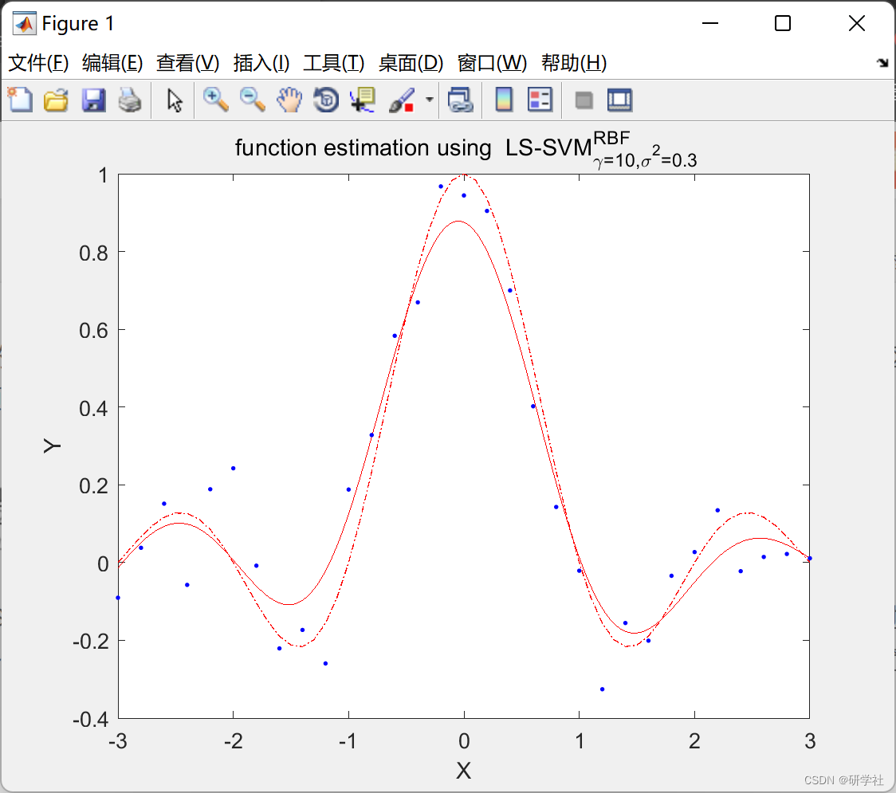
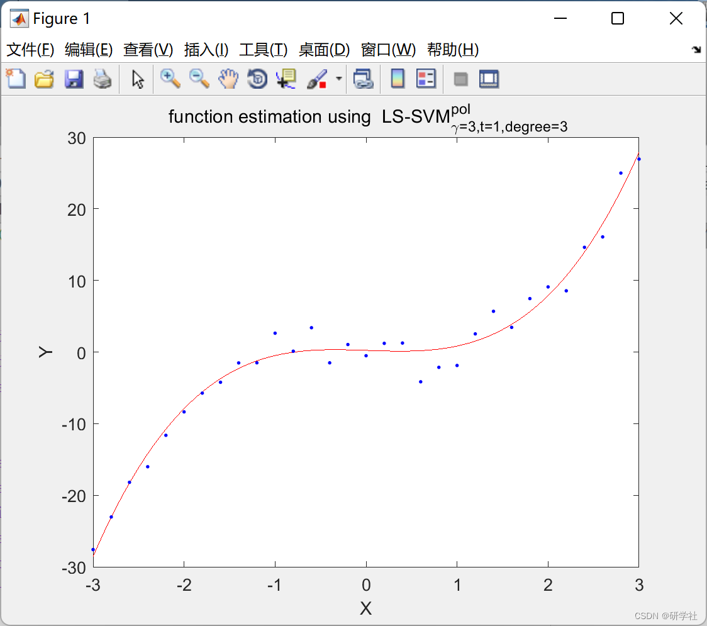
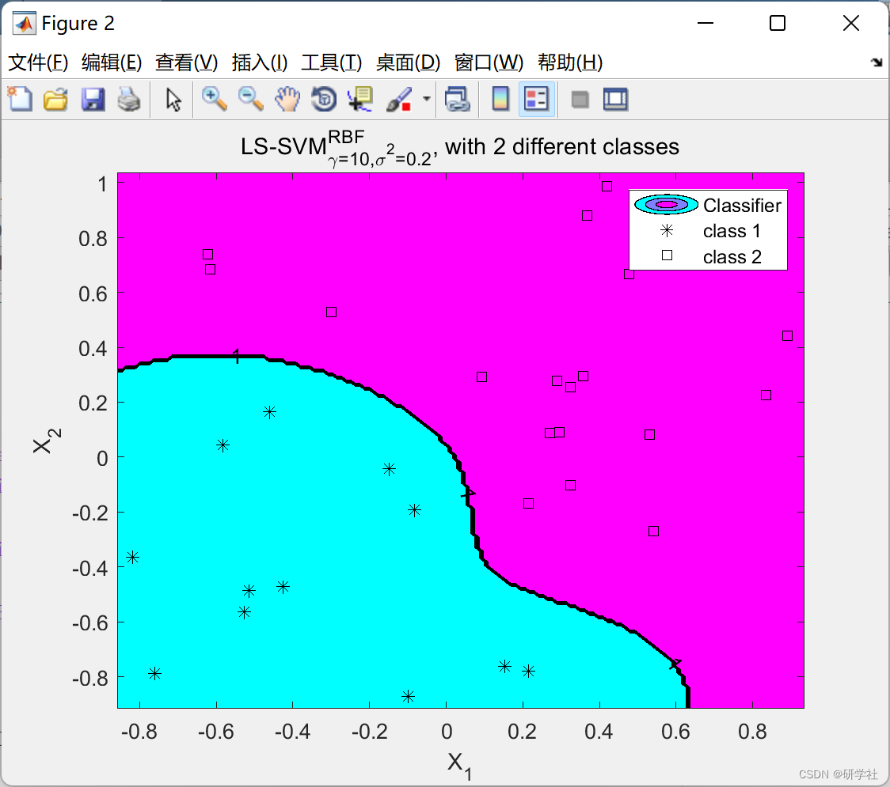
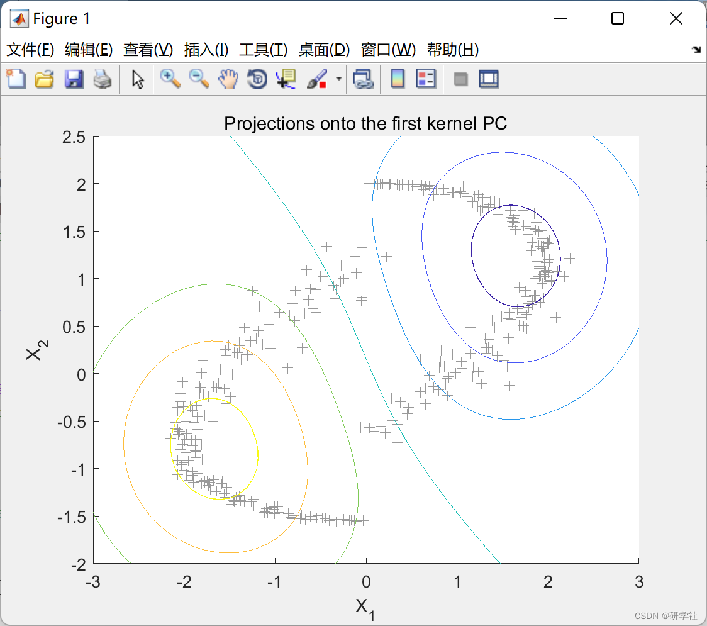
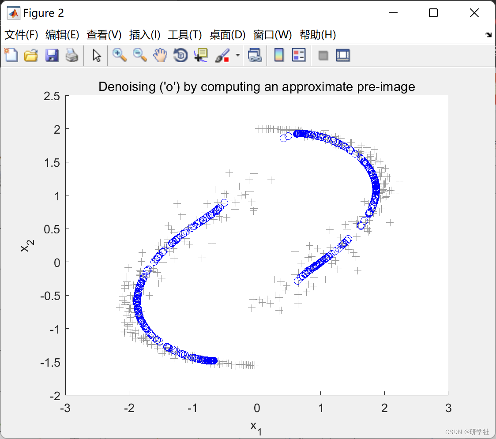
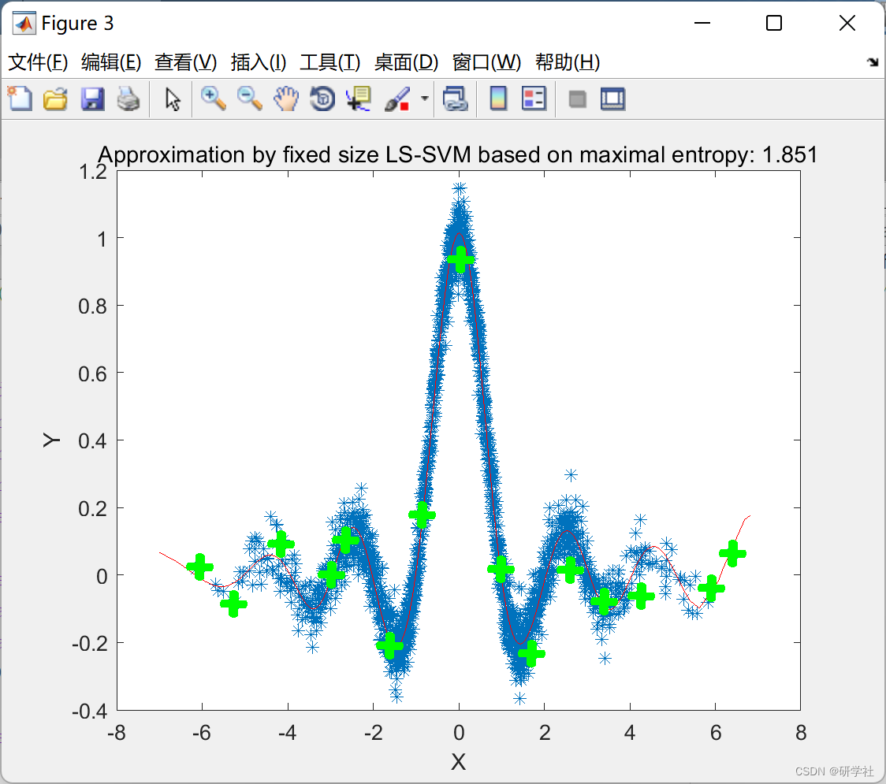
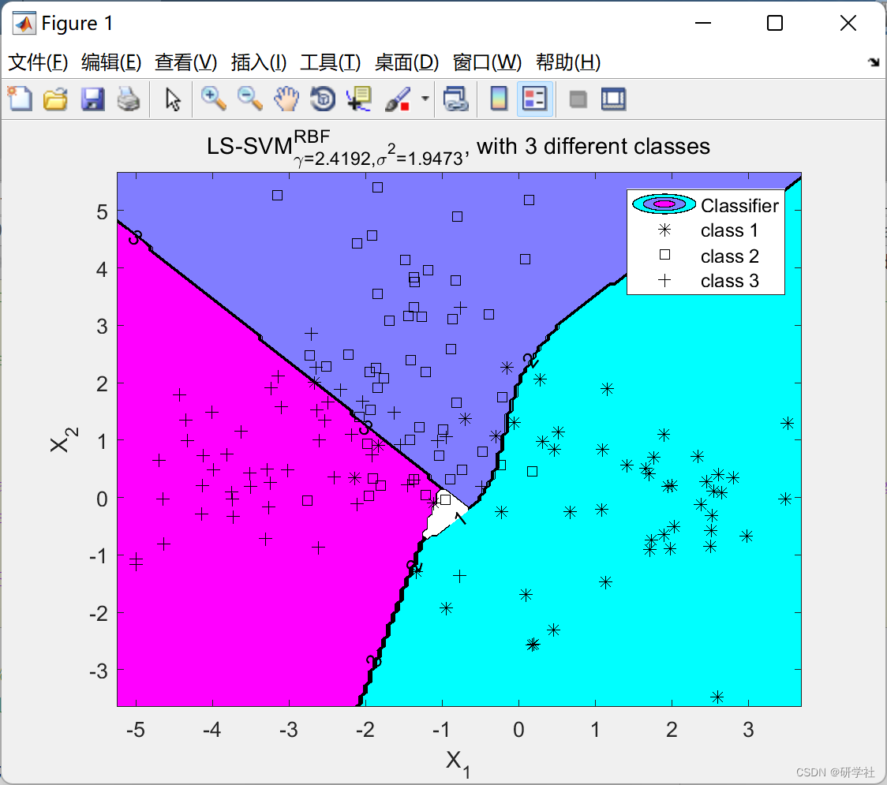

# Signal Prediction Based on LSSVM and PSO (Matlab Code Implementation)

🏆 Bloggers' Advantage: 🌞🌞🌞 The content of the blog strives for rigorous thinking and clear logic to facilitate readers.
⛳️ Mantra: A journey of a thousand miles is begun with a single step.  
💥1 Overview📚  
LSSVM model essence is a classifier, aiming to optimize for the optimal classification margin to minimize the fitting error, in regional railway freight volume prediction, its optimization objective and constraints are represented as follows:
It can be observed that LSSVM optimization aims for an inequality with constraints, which still poses challenges in solving. Introducing Lagrange functions simplifies the solution process. By transforming the original constrained problem into an unconstrained one through Lagrange functions, kernel functions are effectively utilized in high-dimensional spaces to simplify the solution process.  
📚2 Run Results​Edit  
​Edit  
​Edit  
​Edit  
​Edit  
​Edit  
​Edit  
Part of the code:  
eval('distfct;','distfct=''codedist_hamming'';');  
eval('dist;','dist=2'';');  
nb = floor(log2(m*dist));  
codebook = [];  
candidates = eps.*ones(nb,1);  
while isempty(codebook),  
disp(['number of bits ' num2str(nb)]);  
if nb>2^(m-1), error('No such code feasible'); end  
[codebook,sc] = create_code(candidates, m, dist, distfct,[]);  
if isempty(codebook),  
nb=nb+1;
candidates = eps.*ones(nb,1);  
else  
hd=inf;  
hdM = 0;  
for t1=1:size(codebook,1),  for t2=(t1+1):size(codebook,1),  
hd = min(hd,feval(distfct,codebook(t1,:), codebook(t2,:)));  
hdM = max(hdM,feval(distfct,codebook(t1,:), codebook(t2,:)));  
end; end  
if hd==0|hdM==size(codebook,2),  
candidates = sc;  
codebook=[]; disp('retry');  
end  
end  
end  
%  
% output format, where 'b' stands for binary discriminator  
% see also 'code' and 'codelssvm'  
scheme = []; for i=1:nb, scheme = [scheme 'b']; end  
function [code,shrunkcandidate,rc] = create_code(candidates, m, dist, distfct,foundcand)  
%  
% recursive called function  
%  
% base case  
if isempty(candidates), code=[]; shrunkcandidate=[]; rc=0; return; end  
% pick a candidate  
[nb,nc] = size(candidates);  
rc=ceil(rand*nc);  
acode = candidates(:,rc);  
% initate this candidate  
% and remove from the candidate list  
acode = (acode~=eps).*acode;  
aicode = acode +(acode==0).*sign(rand(nb,1)-.5);  
if sum(acode==0)==0,  
candidates = candidates(:,[1:(rc-1) (rc+1):nc]);  
else  
while(acode==aicode),  
aicode = acode + (acode==0).*sign(rand(nb,1));  
end  
end  
aicode = aicode+(aicode==0).*eps;  
acode = acode+(acode==0).*eps;  
candidates = shrink(candidates, aicode, dist, distfct);  
shrunkcandidate = shrink(acode, aicode, dist, distfct);  
% recursion  
if m-1>0,  
shrunkc = candidates;  
fprintf('R;');  
[newcode,shrunkcandidate2,cc] = create_code(candidates,m-1, dist, distfct,[foundcand aicode]);  
fprintf('O;');  
while isempty(newcode),  
if isempty(find(shrunkcandidate2)), code=[]; return; end  
disp('retry with left candidates');  
shrunkc = [shrunkc(:,1:(cc-1)) shrunkcandidate2 shrunkc(:,(cc+1):end)];  
[newcode,shrunkcandidate2,cc] = create_code(shrunkc, m, dist, distfct,foundcand);  
end  
code = [aicode newcode];  
else  
code = aicode;  
end  
shrunkcandidate = candidates;  
function shrunkcandidates = shrinkr(candidates, aicode, dist, distfct)  
% refine candidates according to dist  
% and shrink list of candidates  
%  
% recursive algorithm: TAKE CARE many recursions needed  
fprintf('r');  
% end of recursion  
if isempty(candidates),shrunkcandidates=[]; return; end  
if size(candidates,2)==1 &sum(candidates==eps)==0,shrunkcandidates=[]; return; end  
% recursive step  
cand = candidates(:,1);  
if feval(distfct, aicode', cand)<dist,  
%zi = find(cand==eps & aicode~=eps);  
zi = find(cand==eps);  
if ~isempty(zi),  
ncandn = [cand(1:(zi-1)); -1; cand((zi+1):end)];  
ncandp = [cand(1:(zi-1)); 1; cand((zi+1):end)];  
candidates = [candidates(:,2:end) ncandp ncandn];  
else  
candidates = candidates(:,2:end);  
end  
shrunkcandidates = shrink(candidates,aicode,dist,distfct);  
else  
shrunkcandidates = [cand shrink(candidates(:,2:end),aicode,dist,distfct)];  
end  
fprintf('o');  
function shrunkcandidates = shrink(candidates, aicode, dist, distfct)  
% refine candidates according to dist  
% and shrink list of candidates  
%  
% iteration with dynamical list  
%aicode  
%candidates  
i =1;  
nb = size(candidates,2);  
while i<=nb,  
cand = candidates(:,i);  
if feval(distfct, aicode', cand)<dist,  
zi = find(cand==eps);  
if ~isempty(zi),  
ncandn = [cand(1:(zi-1)); -1; cand((zi+1):end)];  
ncandp = [cand(1:(zi-1)); 1; cand((zi+1):end)];  
[candidates(:,[1:(i-1) (i+1):end]) ncandp ncandn];  
candidates = [candidates(:,[1:(i-1) (i+1):end]) ncandp ncandn];  
else  
candidates(:,[1:(i-1) (i+1):end]);  
candidates = candidates(:,[1:(i-1) (i+1):end]);  
end  
else  
i=i+1;  
end  
nb = size(candidates,2);  
end  
shrunkcandidates = candidates;  
🎉3 References
🌈4 Matlab code implementation

## Images

<!-- PAYMENT_BLOCK -->

## Get this dataset

- Payment link (Stripe): [Buy now](https://buy.stripe.com/3cs8yP7sY87d0vu9AB)
- Payment QR code: 

<!-- /PAYMENT_BLOCK -->
